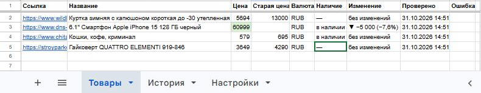
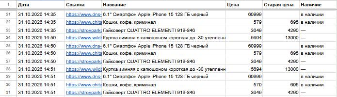
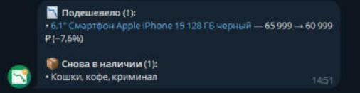

# Price Sheet — мониторинг цен в Google Таблице

[](https://github.com/SHUHER322/price_sheet/actions/workflows/tests.yml)

Следит за ценами конкурентов в любых интернет-магазинах. Вы вставляете в Google Таблицу
ссылки на товары — программа сама заполняет название, цену, старую цену и наличие,
подсвечивает изменения, ведёт историю и присылает в Telegram, что подешевело.

Работает с тысячами магазинов без настройки: большинство сайтов размечают товар для
поисковиков, и парсер читает эту разметку. Для сайтов с защитой от ботов (Wildberries, DNS,
Ozon) включается настоящий браузер Chrome. Для необычного магазина достаточно вписать
CSS-селектор на листе «Настройки» — код менять не нужно.

**Стек:** Python 3.12–3.14, httpx, BeautifulSoup, gspread, patchright (Chrome), Docker,
pytest + GitHub Actions.

## Как это выглядит

**Товары** — цена, изменение с прошлой проверки, наличие; подешевевшие подсвечены зелёным,
подорожавшие — красным:



<table>
  <tr>
    <th>История цен</th>
    <th>Уведомление в Telegram</th>
  </tr>
  <tr>
    <td></td>
    <td></td>
  </tr>
</table>

## Возможности

**Таблица**
- Достаточно вставить ссылку в столбец A — остальные столбцы программа заполнит сама
- Название, цена, старая (зачёркнутая) цена, валюта, наличие, время проверки
- «Изменение» — на сколько и на сколько процентов изменилась цена: `▼ −5 000 (−7,6%)`
- Подсветка: зелёный — подешевело, красный — подорожало
- Лист «История» — каждая проверка отдельной строкой, по ней легко построить график
- Если товар не удалось проверить, прежние данные остаются, а причина пишется в «Ошибку»

**Уведомления в Telegram** (необязательно)
- Одно сообщение после проверки и только когда есть новости: подешевело, снова в наличии,
  закончилось; при желании — и подорожало
- Самые большие скидки — сверху, со ссылкой на товар
- Можно слать нескольким людям или в группу

**Сайты**
- Без настройки: читает разметку schema.org (JSON-LD и микроразметку) и мета-теги,
  которые есть у большинства магазинов
- Wildberries, DNS, Ozon — встроенные настройки, открываются через браузер
- Свой магазин — строка на листе «Настройки»: домен и CSS-селекторы цены, названия,
  старой цены; режим `browser` — открывать только браузером
- Защищённые сайты: если обычный запрос получил заглушку защиты или цена не нашлась,
  страница открывается в Chrome. Cookie сохраняются — в следующий раз сайт пускает сразу

**Бережно к сайтам**
- Страницы разных магазинов загружаются параллельно, но к одному сайту — по одному
  запросу с паузой, чтобы не получить бан
- Проверка по расписанию: раз в N часов (по умолчанию 6)

**Надёжность**
- Одна неудачная проверка (нет интернета, Google недоступен) не останавливает расписание
- Цены разбираются в любом формате: `1 299,90 ₽`, `$1,299.00`, `12.990 р`, `от 990 руб.`
- Токен бота не попадает в логи
- 70+ тестов на сохранённых страницах магазинов, автозапуск в GitHub Actions

## Настройка

### 1. Ключ Google

1. В [Google Cloud Console](https://console.cloud.google.com/) создайте проект и включите
   **Google Sheets API** и **Google Drive API**.
2. «IAM и администрирование» → «Сервисные аккаунты» → создайте аккаунт → «Ключи» →
   «Добавить ключ» → JSON. Сохраните файл в папку проекта как `credentials.json`.
3. Создайте Google Таблицу и откройте к ней доступ **редактора** для почты сервисного
   аккаунта (`...@...iam.gserviceaccount.com`, есть в `credentials.json`).

Листы «Товары», «История» и «Настройки» программа создаст сама при первом запуске.

### 2. Файл `.env`

```
GOOGLE_CREDENTIALS=credentials.json
SPREADSHEET_ID=1AbC...xyz          # часть адреса таблицы между /d/ и /edit
TIMEZONE=Asia/Tomsk                # по нему пишется время проверки
INTERVAL_HOURS=6                   # как часто проверять

BROWSER=auto                       # off — не использовать Chrome
CONCURRENCY=5                      # сколько страниц загружать одновременно
DOMAIN_DELAY=1.5                   # пауза между запросами к одному сайту, сек

TELEGRAM_BOT_TOKEN=                # от @BotFather; пусто — без уведомлений
TELEGRAM_CHAT_ID=123456789         # кому слать, можно несколько через запятую
NOTIFY_PRICE_UP=0                  # 1 — сообщать и о подорожании
```

### 3. Свои сайты — лист «Настройки» (если нужно)

| Домен | Селектор цены | Селектор названия | Селектор старой цены | Режим (auto / browser) |
|---|---|---|---|---|
| shop.example.ru | `.product-price` | `h1` | `.price-old` | auto |
| spa-shop.ru | `[class*="finalPrice"]` | | | browser |

Строка подходит и для поддоменов (`msk.shop.example.ru`). Настройки из таблицы важнее
встроенных — если Wildberries поменяет вёрстку, селектор можно поправить прямо в таблице.

## Запуск

Нужен Python 3.12+ и Google Chrome (для защищённых сайтов).

```bash
python -m venv .venv             # на Windows с несколькими Python: py -V:3.14 -m venv .venv
source .venv/bin/activate        # Windows: .venv\Scripts\activate
pip install -r requirements.txt
cp .env.example .env             # Windows: copy .env.example .env

python -m app.run                # одна проверка
python -m app.watch              # по расписанию, раз в INTERVAL_HOURS часов
```

На Windows проверку по расписанию можно запустить двойным кликом по `run.bat`.

Тесты: `pip install -r requirements-dev.txt && pytest`

## Запуск в Docker (сервер)

В образе уже есть Google Chrome и виртуальный экран: браузер работает «с окном»
(так его реже принимают за бота), хотя у сервера нет монитора.

```bash
cp .env.example .env              # заполнить ID таблицы и Telegram
# положить credentials.json рядом с docker-compose.yml
mkdir -p data                     # здесь хранится профиль браузера (cookie)
docker compose up -d --build      # собрать и запустить в фоне
```

```bash
docker compose logs -f            # логи (выход: Ctrl + C)
git pull && docker compose up -d --build   # обновить код
```

Программа сама поднимается после падения и перезагрузки сервера.

## Как парсер ищет цену

1. CSS-селекторы с листа «Настройки» или встроенные (Wildberries)
2. JSON-LD — `<script type="application/ld+json">` с `Product` (и `Book` и др.)
3. Микроразметка schema.org — `itemprop="price"`
4. Мета-теги `product:price:amount`, `og:title`
5. Старая цена — по типичным классам (`old-price`, `price--old`…), валюта — по тексту страницы

Чего не нашлось в одном источнике, ищется в следующем. Сначала страница загружается
обычным запросом (быстро), браузер — только если сайт защищён или цена появляется скриптом.

## Структура

```
app/
  prices.py   — разбор цены из строки в любом формате
  extract.py  — товар со страницы: селекторы → JSON-LD → микроразметка → мета-теги
  fetch.py    — загрузка страниц: параллельно, с паузой для каждого сайта; распознаёт заглушки защиты
  browser.py  — запасной Chrome (patchright) для защищённых сайтов
  presets.py  — встроенные настройки: Wildberries, DNS, Ozon
  table.py    — чтение листов и подготовка строк (чистые функции)
  sheet.py    — Google Таблица: листы, запись, подсветка, история
  notify.py   — уведомление в Telegram
  run.py      — одна проверка
  watch.py    — проверка по расписанию
tests/fixtures/ — сохранённые страницы магазинов для тестов
```

## Что можно добавить под заказчика

Выгрузка в Excel, графики цен прямо в таблице, сравнение с собственной ценой и расчёт
маржи, мониторинг остатков и продавцов на маркетплейсе, отчёт в Telegram по расписанию,
веб-панель вместо таблицы.
